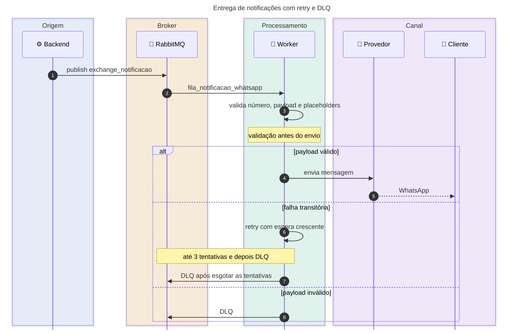

# Studio Essencia - Worker de Mensagens

Worker assíncrono que consome comandos de WhatsApp do RabbitMQ, renderiza o
texto e entrega a mensagem pelo provedor configurado (WAHA, Twilio ou NoOp).

O serviço não expõe HTTP: toda entrada chega pela fila. Ele faz parte da
arquitetura do Studio Essencia ao lado do
[`studio-Essencia-web-backend`](../studio-Essencia-web-backend) e do
[`Studio-Essencia-Front-end`](../Studio-Essencia-Front-end-main).

## Sumário

- [Como funciona](#como-funciona)
- [Diagrama de sequência](#diagrama-de-sequência)
- [Contrato da mensagem](#contrato-da-mensagem)
- [Provedores](#provedores)
- [Como executar](#como-executar)
- [Docker](#docker)
- [Configuração](#configuração)
- [Retentativas e DLQ](#retentativas-e-dlq)
- [Testes](#testes)
- [Segurança](#segurança)

## Como funciona

```text
Backend
  -> exchange_notificacao (direct)
  -> routing key notificacao.whatsapp
  -> fila_notificacao_whatsapp
  -> OuvinteNotificacaoWhatsApp
  -> ServicoEnvioWhatsApp (valida e resolve {{placeholders}})
  -> NotificadorWhatsApp (WAHA / Twilio / NoOp)
```

- O Backend publica o payload JSON após confirmar a transação de negócio.
- O worker valida número, mensagem e parâmetros antes de enviar.
- Números são mascarados nos logs.
- Falhas de validação e de entrega passam pelo retry do listener e terminam na
  DLQ, sem reenfileiramento infinito.

## Diagrama de sequência



<details>
<summary><strong>Ver topologia e política de retry</strong></summary>

| Elemento | Nome | Observação |
| --- | --- | --- |
| Exchange | `exchange_notificacao` | Durável, roteamento direct |
| Fila | `fila_notificacao_whatsapp` | Consumida pelo worker |
| Exchange DLQ | `exchange_notificacao_dlq` | Recebe mensagens rejeitadas |
| Fila DLQ | `fila_notificacao_whatsapp_dlq` | Monitorada no painel do RabbitMQ |
| Retry | 3 tentativas | Espera inicial de 2 s, multiplicador 2 |
| Rejeição | `default-requeue-rejected=false` | Evita loop infinito |

</details>

## Contrato da mensagem

```json
{
  "numero": "5511999999999",
  "mensagem": "Olá, {{nome}}! Seu código é {{codigo}}.",
  "parametros": {
    "nome": "Ana",
    "codigo": "123456"
  }
}
```

| Campo | Obrigatório | Regra |
| --- | --- | --- |
| `numero` | sim | somente dígitos ou formato com `+`; normalizado para E.164 nos provedores que exigem |
| `mensagem` | sim | texto final ou template com `{{chave}}` |
| `parametros` | não | valores usados nos placeholders; chave ausente rejeita a mensagem |

Placeholders aceitam letras, números, ponto, hífen e sublinhado. Parâmetros
extras são aceitos. O texto enviado ao provedor não contém placeholders
parciais.

Exemplo de publicação manual:

<details>
<summary><strong>Ver comando de publicação no RabbitMQ</strong></summary>

```bash
rabbitmqadmin -u "$RABBITMQ_USERNAME" -p "$RABBITMQ_PASSWORD" \
  publish exchange=exchange_notificacao routing_key=notificacao.whatsapp \
  payload='{"numero":"5511999999999","mensagem":"Olá, {{nome}}!","parametros":{"nome":"Ana"}}'
```

</details>

## Provedores

| Provedor | Configuração |
| --- | --- |
| `waha` (padrão) | `WAHA_API_URL`, `WAHA_API_KEY`, `WAHA_SESSION` |
| `twilio` | `TWILIO_ACCOUNT_SID`, `TWILIO_AUTH_TOKEN` ou API Key, `TWILIO_WHATSAPP_NUMBER` |
| `noop` | não envia; útil para desenvolvimento e testes |

Para Twilio, o número de origem deve estar no formato
`whatsapp:+5511987654321`. O destino é normalizado para E.164, assumindo o
Brasil quando o número tem até 11 dígitos.

## Como executar

Pré-requisitos:

- Java 21;
- Maven Wrapper;
- RabbitMQ 4;
- WAHA ou credenciais Twilio se quiser envio real.

1. Copie as variáveis de ambiente:

```powershell
Copy-Item docker/.env.example docker/.env
```

2. Edite `docker/.env` com usuário e senha do RabbitMQ e as credenciais do
   provedor.

3. Suba RabbitMQ e WAHA:

```powershell
docker compose up -d
```

4. Exporte as mesmas credenciais para o processo Java. No PowerShell:

```powershell
$env:RABBITMQ_USERNAME = "usuario-do-worker"
$env:RABBITMQ_PASSWORD = "senha-do-worker"
$env:WAHA_API_URL = "http://localhost:3000"
$env:WAHA_API_KEY = "chave-do-waha"
$env:WAHA_SESSION = "Teste"
$env:WHATSAPP_PROVIDER = "waha"

.\mvnw.cmd spring-boot:run
```

`RABBITMQ_USERNAME` e `RABBITMQ_PASSWORD` são obrigatórios de propósito: não há
fallback `admin/admin`. O worker não inicia sem essas variáveis.

Para testar sem enviar mensagens reais:

```powershell
$env:WHATSAPP_PROVIDER = "noop"
.\mvnw.cmd spring-boot:run
```

## Docker

```powershell
docker build -t studio-Essencia-actions-service .
docker run --rm --env-file docker/.env studio-Essencia-actions-service
```

A imagem usa build multi-stage com Maven e gera um runtime Java mínimo via
`jlink`. O processo roda com usuário não privilegiado e sem porta exposta.

## Configuração

As propriedades ficam em `src/main/resources/application.properties` e podem ser sobrescritas por variáveis de ambiente.

<details>
<summary><strong>Ver tabela completa de variáveis</strong></summary>

| Variável | Padrão | Uso |
| --- | --- | --- |
| `RABBITMQ_HOST` | `localhost` | host do broker |
| `RABBITMQ_PORT` | `5672` | porta AMQP |
| `RABBITMQ_USERNAME` | — | usuário obrigatório |
| `RABBITMQ_PASSWORD` | — | senha obrigatória |
| `RABBITMQ_SSL` | `false` | habilita TLS (`amqps`) |
| `RABBITMQ_LISTENER_AUTO_STARTUP` | `true` | inicia o consumo do listener |
| `WHATSAPP_PROVIDER` | `waha` | `waha`, `twilio` ou `noop` |
| `WAHA_API_URL` | `http://localhost:3000` | URL do WAHA |
| `WAHA_API_KEY` | vazio | API key do WAHA |
| `WAHA_SESSION` | `Teste` | sessão do WAHA |
| `TWILIO_ACCOUNT_SID` | vazio | Account SID |
| `TWILIO_AUTH_TOKEN` | vazio | Auth Token |
| `TWILIO_API_KEY_SID` | vazio | API Key opcional |
| `TWILIO_WHATSAPP_NUMBER` | vazio | número de origem |

</details>

Topologia criada pelo worker:

- exchange durável `exchange_notificacao`;
- fila durável `fila_notificacao_whatsapp`;
- exchange DLQ `exchange_notificacao_dlq`;
- fila DLQ `fila_notificacao_whatsapp_dlq`.

## Retentativas e DLQ

O listener usa:

- 3 tentativas;
- espera inicial de 2 segundos e multiplicador 2;
- `default-requeue-rejected=false`;
- DLQ declarada pela própria aplicação.

Mensagens inválidas ou que falham em todas as tentativas vão para
`fila_notificacao_whatsapp_dlq`. Monitore essa fila no painel do RabbitMQ.

## Testes

```powershell
.\mvnw.cmd test
```

A suíte cobre renderização de placeholders, validação do payload, normalização
de telefone e os notificadores WAHA e Twilio.

## Segurança

- Use um usuário de RabbitMQ exclusivo para o worker, com permissão apenas no
  exchange/fila de notificação.
- Mantenha `docker/.env` fora do Git; o repositório contém apenas
  `.env.example`.
- Em produção, use TLS no broker (`RABBITMQ_SSL=true`) e não exponha as portas
  do RabbitMQ publicamente.
- O WAHA do compose de desenvolvimento pode ficar acessível na porta 3000;
  proteja-o com API key e rede privada em qualquer ambiente compartilhado.
- Não registre números completos nem conteúdo sensível das mensagens em logs.
